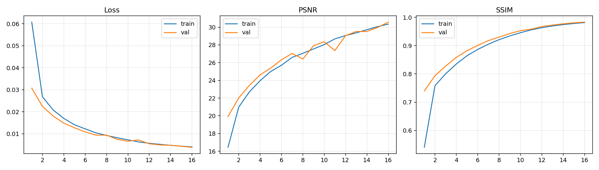
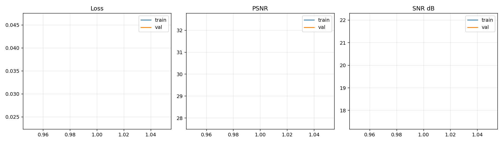
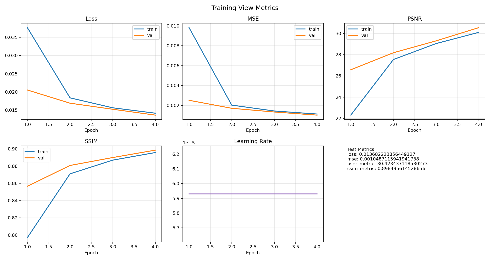
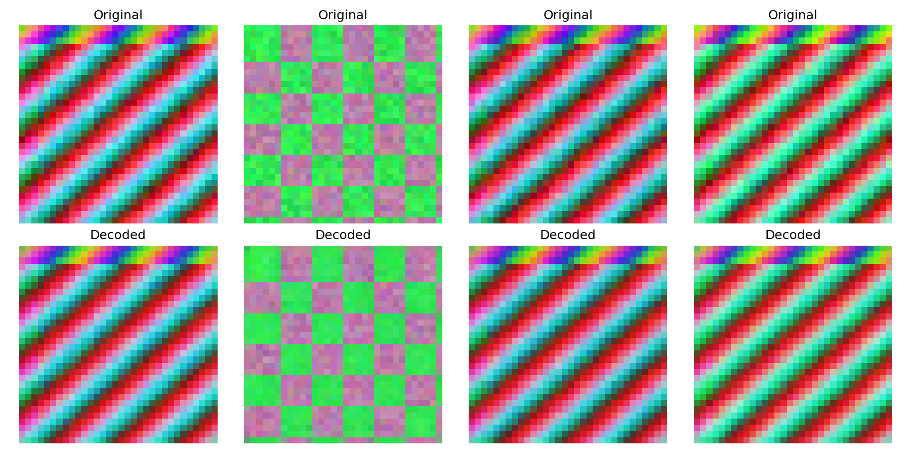
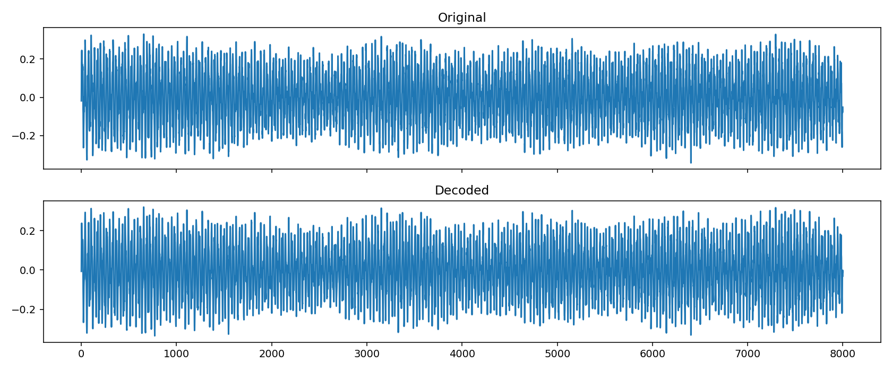
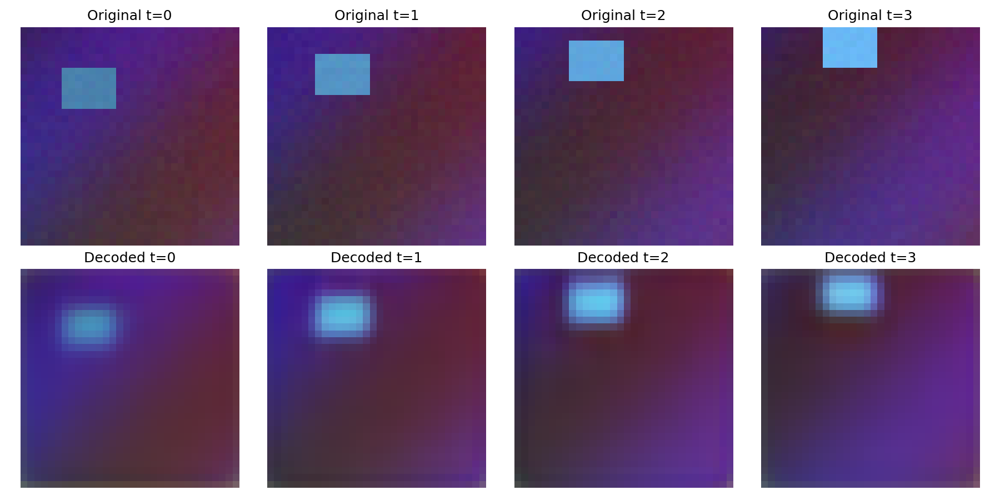

# AI Compressor - Neural Compression for Image, Audio, and Video

Local-first neural compression project with autoencoders for image, audio, and video.

## What is Neural compression

Traditional codecs (JPEG/MP3/H.264) are hand-engineered. Neural compression learns compact latent representations with an encoder/decoder and optimizes reconstruction quality directly for your target data and constraints.

## Current benchmark snapshot (October 2026)

| Modality / Task | Test PSNR | Test MSE | Test Loss | Test SSIM/SNR | Key Focus / Baseline |
|:----------------|----------:|---------:|----------:|--------------:|:---------------------|
| Image (Standard Super-Res) | 72.518 dB | 8.225e-08 | 2.640e-05 | SSIM 0.999999 | 2x Bicubic restoration |
| Image (Lossy Rate-Distortion) | 25.676 dB | 0.00321 | 0.01361 | SSIM 0.9123 | 18.47 bpp, 0.829x JPEG ratio |
| Image (Learned Upscaler) | 26.338 dB | 0.00267 | 0.01947 | SSIM 0.8855 | Outperforms Bicubic (0.8705) |
| Audio (Waveform Autoencoder) | 32.223 dB | 0.00100 | 0.02400 | SNR 21.981 dB | Multi-scale spectral recon |
| Video (Spatio-Temporal AE) | 30.423 dB | 0.00100 | 0.01400 | SSIM 0.8980 | 3D conv latent compression |

Average across best models:

- Test PSNR: **37.436 dB**
- Lossy & Generative average PSNR (Audio, Video, Lossy Image, Upscaler): **28.665 dB**

## Model Hyperparameters
Best model hyperparameters for each modality and architecture (from high-end benchmark configurations):

| Modality / Task | Latent Dim / Channels | Filters / ResBlocks | Learning Rate | Batch Size | Epochs | Optimization / Notes |
|:----------------|----------------------:|--------------------:|--------------:|-----------:|-------:|:---------------------|
| Image (Standard Super-Res) | 192 | 64 base filters | 0.00025 | 32 | 12 | 2x upscale, SSIM + Charbonnier loss |
| Image (Lossy Rate-Distortion) | 48 | 32 base filters | 0.00025 | 32 | 6 | Rate-lambda 0.0006, 8-bit QAT, entropy coding |
| Image (Learned Upscaler) | N/A | 40 filters, 5 resblocks | 0.00025 | 32 | 7 | 2x pixel shuffle, residual blocks |
| Audio (Waveform AE) | 96 (8-bit QAT) | 32 base filters | 0.00012 | 16 | 16 | Continuous phase, 8-bit QAT, 1204.7x measured ratio |
| Video (Spatio-Temporal AE) | 192 | 24 base filters | 0.00010 | 8 | 15 | 3D conv spatio-temporal encoder |

## Training Metrics  (x-axis : Epochs)
### Image Model:

image model training metrics (PSNR, MSE, Loss, SSIM) over epochs
### Audio Model:

audio model training metrics (PSNR, MSE, Loss, SNR) over epochs
### Video Model:

video model training metrics (PSNR, MSE, Loss, SSIM) over epochs

## Preview reconstruction quality of best models
preview of reconstruction quality for best models on test data, showing original and reconstructed samples.
### Image:


### Audio:

Playback audio: [audio_preview_reconstruction.wav](models/production_bundle/best_20260702_235656/audio/audio_preview_waveform.wav)
### Video:


Source reports:

- `models/highend_run/20261013_231532/image_standard/20261013_231537/evaluation_report.md`
- `models/highend_run/20261013_232606/image_lossy/20261013_235837/evaluation_report.md`
- `models/highend_run/20261014_013253/image_upscaler/20261014_013303/upscaler_evaluation_report.md`
- `models/highend_run/20261017_135058/audio/20261017_135103/audio_evaluation_report.md`
- `models/random_search_goal30/video/trial_001/20260702_183130/video_evaluation_report.md`

## Quick start

```zsh
python3 -m venv .venv
source .venv/bin/activate
pip install --upgrade pip
pip install -r requirements.txt
```

## Core commands

### High-End Multi-Modality Orchestrator (`trainhighend`)

Execute high-end training pipelines across all modalities with optimal hyperparameter selection:

```zsh
# Inspect pipeline plan without training
./trainhighend --dry-run

# Run high-end training for a specific modality
./trainhighend --only image_standard
./trainhighend --only image_lossy
./trainhighend --only image_upscaler
./trainhighend --only audio
./trainhighend --only video

# Run all jobs with scaled epochs (e.g. 50% for faster smoke iteration)
./trainhighend --epochs-scale 0.5 --output-root models/highend_run
```

For easier model configuration, all autoencoder trainers also support `--params-file` (JSON). See `documentation/MODEL_PARAMS_INPUT.md` and `documentation/model_params_example.json`.

Train image:

```zsh
python src/training/train_autoencoder_image_local.py --preset m1-air-balanced --data-dir data --output-root models/local_run
```

Train image on real data only (crop-based patch expansion, no dummy fallback):

```zsh
python src/training/train_autoencoder_image_local.py --preset m1-air-quality --data-dir data/ImageData --real-only --train-patches-per-image 6 --upscale-factor 2 --degrade-interp bicubic --target-psnr 60 --output-root models/image_real_only
```

To reuse decoded real-image tensors across repeated runs, add an opt-in cache directory:

```zsh
python src/training/train_autoencoder_image_local.py --preset custom --data-dir data/ImageData/archive --real-only --epochs 8 --batch-size 4 --block-size 64 --cache-dir models/cache/image --no-export-tflite --output-root models/image_cached_local
```

Train image with explicit split folders and external holdout (no split leakage):

```zsh
python src/training/train_autoencoder_image_local.py --preset custom --train-dir "data/cifar10 2/train" --val-dir "data/cifar10 2/val" --test-dir "data/cifar10 2/test" --holdout-dir data/ImageData --real-only --disable-target-psnr-stop --target-psnr 50 --epochs 20 --batch-size 8 --block-size 64 --train-patches-per-image 2 --upscale-factor 2 --degrade-interp bicubic --output-root models/image_explicit_split
```

Train image (lossy + file-size focused):

```zsh
python src/training/train_autoencoder_image_lossy_local.py --preset custom --train-dir "data/cifar10 2/train" --val-dir "data/cifar10 2/val" --test-dir "data/cifar10 2/test" --real-only --epochs 28 --batch-size 8 --block-size 96 --latent-dim 64 --rate-lambda 0.006 --jpeg-quality 88 --target-compression-ratio 0.85 --output-root models/image_lossy_local_run
```

Train image (lossy, less aggressive, real-data-only):

```zsh
python src/training/train_autoencoder_image_lossy_local.py --preset custom --train-dir "data/cifar10 2/train" --val-dir "data/cifar10 2/val" --test-dir "data/cifar10 2/test" --real-only --epochs 40 --batch-size 6 --block-size 128 --latent-dim 96 --rate-lambda 0.004 --sample-count 32 --jpeg-quality 90 --target-compression-ratio 0.80 --output-root models/image_lossy_real_only
```

The lossy trainer writes matched-PSNR JPEG/WebP baseline benchmark stats into `evaluation_report.md` by default. Disable with `--no-run-baseline-benchmark`.

Train image (lossy, real latent bitrate + entropy coding + QAT bit-depth, see `documentation/MODEL_PARAMS_INPUT.md`):

```zsh
python src/training/train_autoencoder_image_lossy_local.py --preset custom --use-cifar10 --epochs 20 --batch-size 8 --block-size 64 --latent-dim 48 --rate-loss-mode entropy --latent-bit-depth 6 --quant-noise-anneal --enable-entropy-coding --output-root models/image_lossy_entropy_run
```

Train a learned image upscaler (Milestone 3; see `documentation/MODEL_PARAMS_INPUT.md`):

```zsh
python src/training/train_upscaler_image_local.py --preset m1-air-balanced --use-cifar10 --output-root models/upscaler_local_run
```

Use the learned upscaler in place of BICUBIC when upscaling reconstructions:

```zsh
python src/reporting/upscale_reconstructed_images.py --model models/local_run/<run>/best_model.keras --upscaler-mode learned --learned-upscaler-model models/upscaler_local_run/<run>/best_model.keras --data-dir data/ImageData
```

Train audio:

```zsh
# Baseline unquantized training (float32 latent representation)
python src/training/train_autoencoder_audio_local.py --preset m1-air-balanced --output-root models/audio_local_run

# Milestone A1: Quantization-Aware Training (QAT) with 8-bit discrete latent quantization and noise annealing
python src/training/train_autoencoder_audio_local.py --preset m1-air-balanced --latent-bit-depth 8 --quant-noise-anneal --output-root models/audio_local_run

# Milestone A3: Perceptual quality training with psychoacoustic A-weighting, log-mel loss, and perceptual evaluation
python src/training/train_autoencoder_audio_local.py --preset m1-air-balanced --loss-profile perceptual --eval-perceptual-metrics --output-root models/audio_local_run

# Milestone A4: Robust audio training with polyphase resampling, noise augmentation, and multi-channel support
python src/training/train_autoencoder_audio_local.py --preset m1-air-balanced --channels mono --resample-method polyphase --augment-noise-std 0.02 --output-root models/audio_local_run
```

Prepare canonical audio dataset (mp3/flac/ogg/wav -> mono PCM16 WAV + metadata):

```zsh
python src/audio/prepare_audio_dataset.py --input-dir data/AudioData --output-dir data/AudioData_canonical --target-sample-rate 16000 --output-format wav --normalization rms_peak --target-rms 0.12 --target-peak 0.95 --remove-dc
```

Run real-time streaming audio compression (Milestone A2):

```zsh
# Run chunked overlap-add streaming inference through a trained autoencoder
python src/audio/realtime_audio_compression_pipeline.py --model-path models/audio_local_run/<run>/best_audio_model.keras --stream-seconds 5.0
```

> [!NOTE]
> `src/audio/realtime_audio_compression_pipeline.py` executes the actual trained neural autoencoder in chunked overlap-add windows over streaming PCM audio with bounded latency. This is distinct from `src/audio/realtime_audio_vortex_pipeline.py` / `src/audio/vortex_realtime_demo.py`, which are feature-extraction-only visualizers (FFT energy bands -> fluid simulation controls) that do not run model inference.

Train video:

```zsh
python src/training/train_autoencoder_video_local.py --preset m1-air-balanced --output-root models/video_local_run
```

Supported real-video extensions for training/comparisons: `.mp4`, `.mov`, `.mkv`, `.avi`, `.webm`, `.m4v`.

Generate real audio/video comparison panels:

```zsh
python src/reporting/generate_real_av_comparisons.py --audio-dir data/AudioData/ESC-50-master/audio --video-dir "data/VIDEO DATA"
```

Run constrained random search:

```zsh
python src/training/random_search_hyperparams.py --modality image --resource-profile tiny --trials 10 --max-minutes 25
python src/training/random_search_hyperparams.py --modality image --image-trainer lossy --resource-profile tiny --trials 10 --max-minutes 25
python src/training/random_search_hyperparams.py --modality audio --resource-profile balanced --trials 12 --search-config documentation/random_search_profile.json
```

Random-search spaces/fixed args can be centrally edited in `documentation/random_search_profile.json` (see `documentation/RANDOM_SEARCH_PROFILE.md`).

Run full production pipeline (search -> train image upscaler/lossy/audio -> bundle -> optional prune):

```zsh
python src/pipeline/run_full_production_pipeline.py --trials-image-standard 10 --trials-image-lossy 10 --trials-audio 8
python src/pipeline/run_full_production_pipeline.py --trials-image-standard 10 --trials-image-lossy 10 --trials-audio 8 --apply-prune
```

Smoke test:

```zsh
python tests/smoke/smoke_test_random_search.py
python tests/smoke/smoke_test_image_lossy_local.py
python tests/smoke/smoke_test_upscaler_local.py
python tests/smoke/smoke_test_audio_local.py
python tests/smoke/smoke_test_realtime_audio_compression.py
python tests/smoke/smoke_test_vortex_pipeline.py
python tests/smoke/smoke_test_prepare_audio_dataset.py
python tests/smoke/smoke_test_full_production_pipeline.py
```

## Outputs

Each run writes artifacts and metrics under `models/.../<timestamp>/` including:

- model weights/checkpoints (`.h5`, `.keras`, optionally `.tflite`)
- training curves (`*.png`)
- evaluation reports (`evaluation_report.md`, `audio_evaluation_report.md`, `video_evaluation_report.md`)

Audio preparation pipeline outputs canonical files under your chosen `--output-dir` with per-file sidecars (`*.metadata.json`) and a run report (`preparation_report.md`).

## Project constraints

- Optimized for laptop iteration; compute and thermal limits constrain model size and epochs.
- Image trainers in this repo are now intended for real-data and CIFAR-backed runs; keep explicit train/val/test splits where possible.
- Search loops are sequential and wall-clock bound.
- Video is the most expensive path and highly sensitive to clip shape (`frames`, `height`, `width`).

## Better hardware path

On stronger GPUs/cloud, prioritize:

1. More real data with cleaner split hygiene.
2. Larger models (`latent_dim`) and longer schedules (`epochs`).
3. Higher-fidelity inputs (bigger image patches, longer audio clips, larger video clips).
4. Broader/parallel hyperparameter search.
5. Deployment metrics (latency, memory, throughput) in addition to PSNR/SSIM/SNR.
