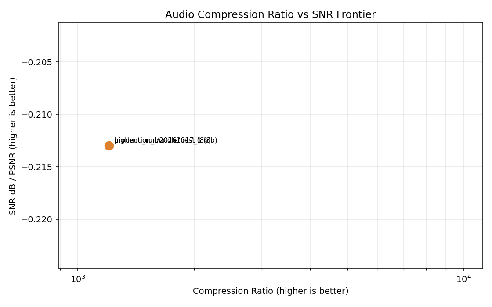

# Master Training & Compression Report

Generated: `2026-10-17T10:56:01.945429Z`

## Major Runs

| Modality | Run Tag | Report Path | PSNR | SSIM | MSE | Loss | SNR dB |
|---|---|---|---:|---:|---:|---:|---:|
| Image | synthetic_best | `models/local_run/20260626_005606/evaluation_report.md` | - | - | - | - | - |
| Image | real_prod | `models/local_real_run/20260629_101835/evaluation_report.md` | - | - | - | - | - |
| Image | tuned_fast | `models/local_run_tuned_fast/20260629_065112/evaluation_report.md` | - | - | - | - | - |
| Image | realdata_psnr30 | `models/image_realdata_psnr30/20260629_150224/evaluation_report.md` | - | - | - | - | - |
| Image | realdata_psnr30_try2 | `models/image_realdata_psnr30_try2/20260629_150721/evaluation_report.md` | - | - | - | - | - |
| Audio | baseline | `models/audio_local_run/20260627_161410/audio_evaluation_report.md` | - | - | - | - | - |
| Audio | real_run_v2 | `models/audio_real_run_v2/20260629_125927/audio_evaluation_report.md` | - | - | - | - | - |
| Audio | realdata_opt_smoke | `models/audio_realdata_opt_smoke/20260629_145612/audio_evaluation_report.md` | - | - | - | - | - |
| Audio | master_highend | `models/highend_run/20261017_135058/audio/20261017_135103/audio_evaluation_report.md` | 19.155 | - | 0.016661 | 0.341172 | -0.213 |
| Video | tuned_fast2 | `models/video_local_run_tuned_fast2/20260629_070559/video_evaluation_report.md` | - | - | - | - | - |
| Video | realdata_opt_smoke | `models/video_realdata_opt_smoke/20260629_145842/video_evaluation_report.md` | - | - | - | - | - |
| Bundle | production_bundle | `models/production_bundle/best_20261017_135322/metadata.json` | - | - | - | - | - |

## Production Bundle Selection

- Bundle dir: `/Users/tyejaedon/PycharmProjects/AI_Compressor/models/production_bundle/best_20261017_135322`
- Strategy: `highest test_metrics.psnr_metric per modality`
- Created: `2026-10-17T10:53:22.252247Z`

| Modality | Best PSNR | Source Run Dir | Copied Files |
|---|---:|---|---|
| image | 72.518 | `highend_run/20261013_231532/image_standard/20261013_231537` | `best_model.keras`, `evaluation_report.md`, `preview_reconstructions.png`, `production_model.weights.h5`, `training_metrics.png` |
| audio | 19.155 | `highend_run/20261017_135058/audio/20261017_135103` | `audio_evaluation_report.md`, `audio_model.weights.h5`, `audio_mp3_benchmark.md`, `audio_preview_reconstruction.wav`, `audio_preview_waveform.png`, `audio_training_metrics.png`, `best_audio_model.keras` |

## JPEG / Other Lossy Image Baseline (Real Data)

Dataset sampled from: `data/ImageData/archive/data`

| Codec | Quality | Samples | Mean PSNR | Mean SSIM | Mean Size Ratio vs Raw RGB |
|---|---:|---:|---:|---:|---:|
| JPEG | 95 | 24 | 47.122 | 0.9831 | 0.1087 |
| JPEG | 85 | 24 | 42.656 | 0.9696 | 0.0690 |
| JPEG | 75 | 24 | 42.023 | 0.9573 | 0.0542 |
| JPEG | 50 | 24 | 41.574 | 0.9322 | 0.0382 |
| WEBP | 90 | 24 | 40.566 | 0.9738 | 0.0611 |
| WEBP | 75 | 24 | 36.270 | 0.9487 | 0.0347 |
| WEBP | 50 | 24 | 34.554 | 0.9316 | 0.0266 |

## Audio Compression-Ratio vs SNR Frontier (Milestone A5)

| Run | Bit Depth | Loss Profile | Actual Ratio | Est Ratio | SNR (dB) | PSNR |
|---|---:|---|---:|---:|---:|---:|
| `highend_run/20261017_135058/audio/20261017_135103` | 8b | `balanced` | 1204.71x | 83.33x | -0.21 | 19.15 |
| `production_bundle/best_20261017_135322/audio` | 8b | `balanced` | 1204.71x | 83.33x | -0.21 | 19.15 |

## Notes

- JPEG/WebP baselines are classic lossy codecs on full-resolution images.
- Model PSNR/SSIM values above come from run reports and may use resized model input dimensions.
- Audio MP3 benchmark in `audio_real_run_v2` is marked skipped due to ffmpeg unavailability at that run time.
